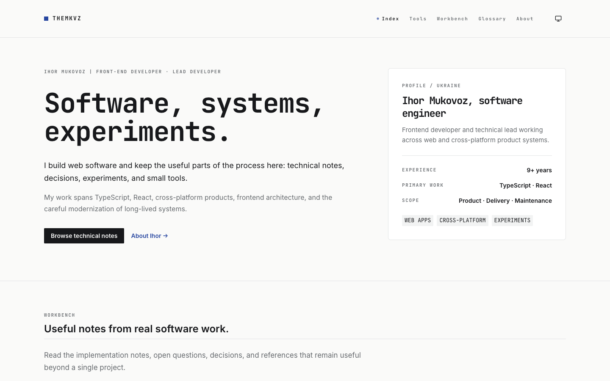
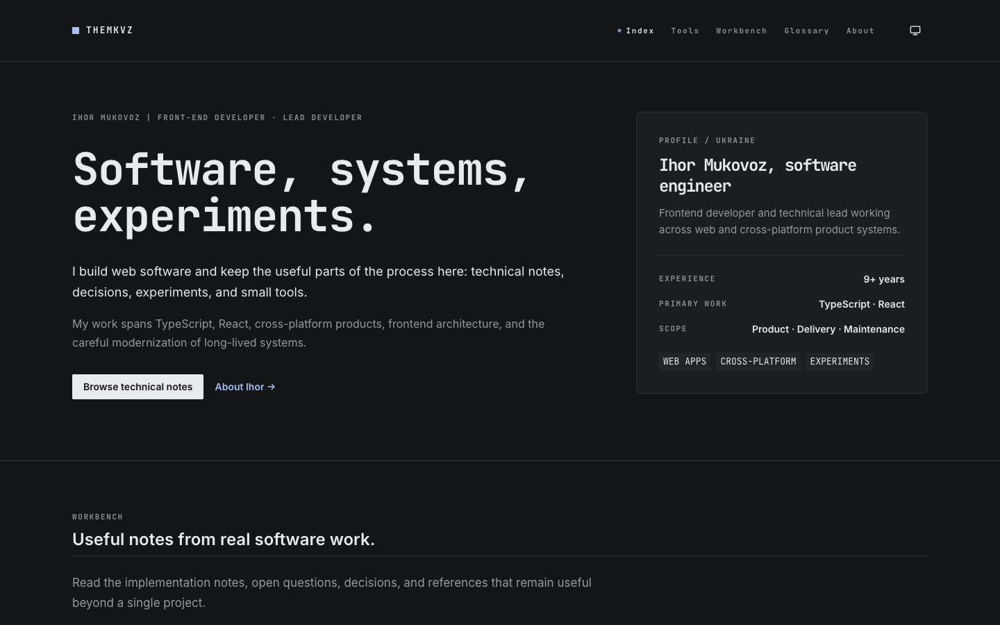
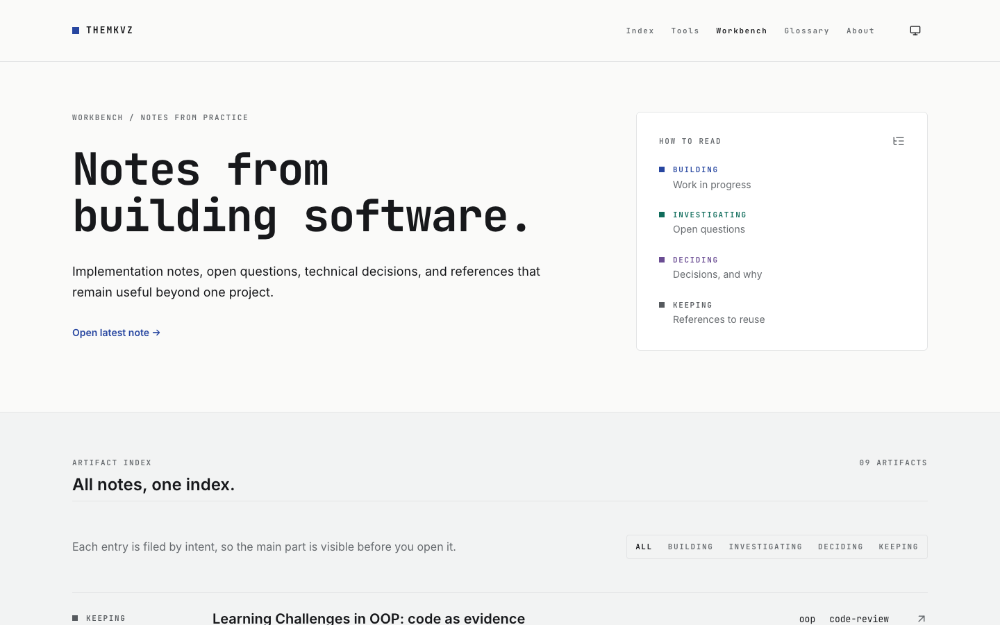
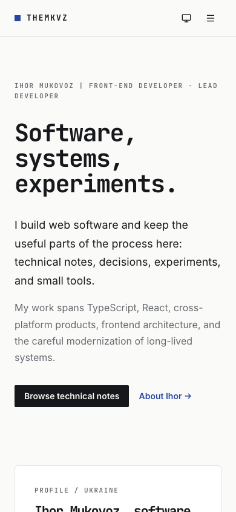
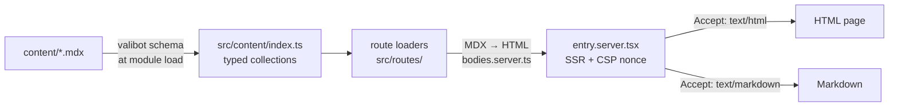

# themkvz.com

Source code for [themkvz.com](https://themkvz.com), the personal engineering workbench of Ihor Mukovoz: technical notes, decisions, investigations, a glossary, and small tools.

**Live:** <https://themkvz.com>

The site is open so other developers can read how it is built. It is not a template or a library, but the content layer, SSR setup, and design system may be useful as a reference for a React Router 8 project.



<details>
<summary>More screenshots</summary>

| Dark theme | Workbench | Mobile |
| --- | --- | --- |
|  |  |  |

</details>

## Key features

- **MDX content, no database or CMS.** Every note, glossary term, tool card, and experience entry is an MDX file in [`content/`](content). Adding a file is the only publishing step.
- **Server-side rendering.** React Router 8 in framework mode. Content bodies are rendered to HTML on the server, so no MDX body ships in the client bundle.
- **Token-driven design system.** Tailwind CSS 4 with OKLCH tokens, documented in [`DESIGN.md`](DESIGN.md). Light, dark, and system themes, applied before first paint.
- **Readable by machines.** Pages return Markdown when the request asks for `text/markdown`. The site also serves `llms.txt`, an RSS feed, a sitemap, `security.txt`, and an API catalog.

## Architecture



Notable decisions:

- **Content is code.** `import.meta.glob` builds one index per collection, and `valibot` validates every frontmatter block, so a malformed file fails the build instead of the page. Drafts (`draft: true`) are indexed only in development.
- **File-based routes** with `@react-router/fs-routes`. Loaders read content directly; the site has no forms and no mutating actions.
- **Layered components** with a one-way dependency direction: `layout → composites → atoms → ui → lib`. `ui/` holds vendored shadcn primitives built on Base UI.
- **Typed environment.** `@t3-oss/env-core` with `valibot` schemas. The server refuses to start without required variables, and `verify:bundle` checks that no server secret reaches the client bundle.
- **Security headers.** Each response gets a nonce-based, report-only Content Security Policy. Violation reports go to GlitchTip.
- **Observability and experiments.** GlitchTip (Sentry SDK) for errors, OpenPanel for analytics, and GrowthBook for experiments. The GrowthBook payload is loaded on the server, so the browser never calls GrowthBook.

Design and planning records live in [`openspec/`](openspec).

## Stack

| Tool | Version | Role |
| --- | --- | --- |
| React Router | `8.4.0` | Framework mode, SSR, file-based routes |
| React | `19.3` | UI |
| TypeScript | `7.0.2` | Strict type checks |
| Tailwind CSS | `4.3.3` | Styling with design tokens |
| Base UI | `1.8` | Accessible primitives under `src/components/ui/` |
| MDX + valibot | `3.1` / `1.4` | Content and frontmatter validation |
| Biome | `2.5.14` | Lint and format |
| Bun | `1.4.4` | Package manager and test runner (`bun.lock`) |

## Getting started

Requires [Bun](https://bun.sh) `1.4.4`+.

```bash
bun install
cp .env.example .env   # fill in the values; see docs/deployment.md
bun run dev            # http://localhost:5173
```

The server validates its environment at startup and stops if a required variable is missing.

## Commands

| Script | Behavior |
| --- | --- |
| `bun run dev` | Development server |
| `bun run build` | Production build |
| `bun start` | Serve the production build |
| `bun run typecheck` | React Router typegen + `tsc` |
| `bun run lint` | Biome lint and format check (`lint:fix` applies fixes) |
| `bun run format` | Format with Biome |
| `bun test` | Unit tests |
| `bun run verify:bundle` | Fails if a server-only variable name is in `build/client` |
| `bun run audit` | Dependency audit with the reviewed ignores |
| `bun run doctor` | React Doctor diagnostics ([details](docs/diagnostics.md)) |

Git hooks (Husky): **pre-commit** runs Biome on staged files through lint-staged; **pre-push** runs `bun run audit`.

## Testing

```bash
bun test
```

Tests cover related-content ranking, page metadata, and Markdown responses. The HTTP test for Markdown responses needs a running server and is skipped otherwise:

```bash
MARKDOWN_TEST_ORIGIN=http://localhost:5173 bun test src/lib/markdown.server.test.ts
```

## Adding content

Add, edit, or delete an MDX file under `content/workbench/`, `content/glossary/`, `content/tools/`, or `content/experience/`, then rebuild. Templates are in [`content/templates/`](content/templates), and [`src/content/schema.ts`](src/content/schema.ts) defines the required frontmatter.

## Documentation

- [Deployment](docs/deployment.md): environment variables, Docker, and self-hosting
- [React diagnostics](docs/diagnostics.md): React Doctor usage and baseline history
- [Design system](DESIGN.md): tokens, type scale, layout, and components

## Contributing

This is a personal site, so pull requests with new features are not expected. Bug reports and corrections are welcome as [issues](https://github.com/themkvz/personal-website/issues). For security problems, see [`/.well-known/security.txt`](https://themkvz.com/.well-known/security.txt).

## Credits

- Fonts: [Inter](https://rsms.me/inter/) and [JetBrains Mono](https://www.jetbrains.com/lp/mono/), self-hosted from [Fontsource](https://fontsource.org/) under the SIL Open Font License.
- Icons: [Lucide](https://lucide.dev/) (ISC) and [Simple Icons](https://simpleicons.org/) (CC0). Brand logos belong to their owners.
- Design: made in [pen.dev](https://pen.dev/) (`design/*.pen`).
- AI assistance: the code was written with help from AI coding tools. The writing in `content/` is my own, edited with AI for grammar and structure. The social preview image (`public/dottt.webp`) was generated with AI. The hero shader was made without AI.

## License

- Code: [MIT](LICENSE) © Ihor Mukovoz
- Writing in [`content/`](content): [CC BY 4.0](content/LICENSE.md)
